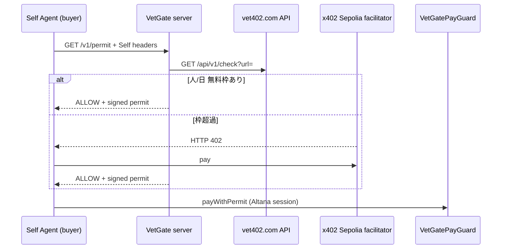

# VetGate (Celo Sepolia 試験版)

## 審査用クイック確認カード

| 項目 | 値（プレースホルダ） |
|---|---|
| ネットワーク | Celo Sepolia `11142220` |
| Self Agent ID | _未登録 — オーナー登録待ち_ |
| ERC-8004 agentId | _未登録_ |
| ERC-8021 attribution | `celo_enrollment_pending`（[chain.ts:15](src/chain.ts#L15)） |
| PayGuard デプロイ tx | _未実施_（[TESTNET_RUN.md](TESTNET_RUN.md)） |
| x402 決済 tx | _未実施_（`X402_API_KEY` 要） |
| Altana session / execute tx | _未実施_（faucet/Captcha 停止） |

## ワンコマンド再現

```bash
forge test --summary && npm test
```

## トラック要件チェックリスト

| 要件 | 実装 |
|---|---|
| PayGuard: ALLOW 署名付き permit のみ送金 | [VetGatePayGuard.sol:65-87](contracts/VetGatePayGuard.sol#L65-L87) |
| revert: `ExpiredPermit` | [VetGatePayGuard.sol:96](contracts/VetGatePayGuard.sol#L96)・[テスト](test/VetGatePayGuard.t.sol#L88-L94) |
| revert: `VerdictNotAllow` | [VetGatePayGuard.sol:97](contracts/VetGatePayGuard.sol#L97)・[テスト](test/VetGatePayGuard.t.sol#L96-L103) |
| revert: `NonceAlreadyUsed` | [VetGatePayGuard.sol:99](contracts/VetGatePayGuard.sol#L99)・[テスト](test/VetGatePayGuard.t.sol#L105-L117) |
| revert: `InvalidSignature` | [VetGatePayGuard.sol:105](contracts/VetGatePayGuard.sol#L105)・[テスト](test/VetGatePayGuard.t.sol#L138-L151) |
| revert: `AmountExceedsPermit` | [VetGatePayGuard.sol:98](contracts/VetGatePayGuard.sol#L98)・[テスト](test/VetGatePayGuard.t.sol#L119-L136) |
| revert: `TransferFailed` | [VetGatePayGuard.sol:78](contracts/VetGatePayGuard.sol#L78)・[テスト](test/VetGatePayGuard.t.sol#L153-L160) |
| `Attribution(bytes)` イベント | [VetGatePayGuard.sol:84-86](contracts/VetGatePayGuard.sol#L84-L86) |
| Self `sybilLimit(0)` + 人ごと日次無料枠 | [app.ts:102](src/app.ts#L102)・[daily-quota.ts:8-19](src/daily-quota.ts#L8-L19) |
| 未認証 → 401/403 JSON | [app.ts:167-179](src/app.ts#L167-L179)・[server.test.ts:37-46](test/server.test.ts#L37-L46) |
| 無料枠超過 → x402 402 | [app.ts:179-220](src/app.ts#L179-L220)・[server.test.ts:110-132](test/server.test.ts#L110-L132) |
| vet402 `GET /api/v1/check` | [vet402.ts:13-19](src/vet402.ts#L13-L19) |
| ALLOW 時 EIP-712 `VetGatePermit` | [permit.ts:31-79](src/permit.ts#L31-L79) |
| `GET /v1/stats` チーム/独立集計 | [stats.ts:17-44](src/stats.ts#L17-L44)・[app.ts:157-159](src/app.ts#L157-L159) |
| Altana: `calls=[PayGuard]`, spend, expiry | [agent-buyer.ts:112-122](src/agent-buyer.ts#L112-L122) |
| BLOCK → `revokeSession` | [agent-buyer.ts:139-158](src/agent-buyer.ts#L139-L158) |
| ALLOW → `payWithPermit` + attribution suffix | [agent-buyer.ts:160-178](src/agent-buyer.ts#L160-L178) |
| Altana ライブ / モック切替 | [agent-buyer.ts:61-63](src/agent-buyer.ts#L61-L63) |
| 試験網鍵生成（非表示） | [scripts/gen-testnet-key.ts](scripts/gen-testnet-key.ts) |

## アーキテクチャ（概要）



## 正直な会計（external vs 自己）

| 区分 | 根拠 |
|---|---|
| 無料枠・x402 の区別は `tier` フィールド | [app.ts:199-207](src/app.ts#L199-L207) |
| チーム財布は `VETGATE_TEAM_WALLETS` | [stats.ts:41-49](src/stats.ts#L41-L49) |
| オンチェーン tx 件数 | **0**（[TESTNET_RUN.md](TESTNET_RUN.md) — コードは生成していない） |
| forge テスト通過数 | **9**（`forge test --summary` の出力のみ） |
| npm テスト通過数 | **7**（`npm test` の出力のみ） |

## 制約

- Celo Sepolia（11142220）のみ。mainnet 42220 は参照・送信しない（[chain.ts:1-2](src/chain.ts#L1-L2)）。
- push / 公開 GitHub / 公開ホストデプロイは行わない。

## オーナー待ち

- Loops 登録による本番 attribution コード
- Self Agent ID 登録（Celo Sepolia モック旅券）
- `X402_API_KEY`（https://x402.celo.org）
- Faucet: CELO（Captcha または API キー）、USDC（Circle faucet）